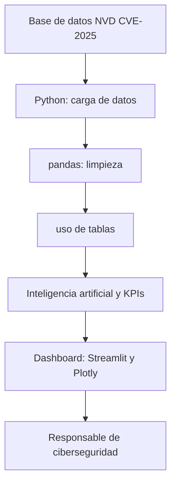

# VulnerabilidadesIAdata — Un análisis inteligente de vulnerabilidades CVE
# 1.Introducción

VulnerabilidadesIAdata es un proyecto de ciberseguridad e inteligencia artificial que quiere ayudar a las empresas a analizar y priorizar vulnerabilidades informáticas.

Para desarrollar este proyecto usaremos datos de la National Vulnerability Database (NVD), publicados por el National Institute of Standards and Technology (NIST) de Estados Unidos.

Lo que queremos lograr es estudiar las características de las vulnerabilidades CVE y diseñar una solución que ayude a identificar patrones de riesgo, visualizar información importante y apoyar las decisiones de los equipos de ciberseguridad.

En esta primera fase se presenta la propuesta del proyecto. El sistema de inteligencia artificial se desarrollarán en las siguientes fases del curso.

# 2.Mi Dataset

Para este proyecto se ha seleccionado la National Vulnerability Database (NVD), una base de datos pública de vulnerabilidades informáticas NIST de Estados Unidos.

Utilizaremos el archivo `nvdcve-2.0-2025.json`, descargado desde la página oficial de NVD. Este archivo contiene información sobre vulnerabilidades identificadas mediante códigos CVE,(no escogí la de este año 2026 dado que no se ha acabado aún, por lo que los datos no estaban completos aún) incluyendo descripciones, fechas de publicación, puntos de gravedad y categorías de debilidades.

Estos datos permitirán estudiar los tipos de vulnerabilidades más habituales, analizar sus niveles de gravedad e investigar qué características pueden ayudar a clasificarlas mediante técnicas de inteligencia artificial.

Antes de desarrollar el modelo, se necesita revisar la calidad de los datos, identificar registros incompletos y seleccionar las variables justas para evitar conclusiones erróneas.

# 2.1 Ficha del dataset

| Campo | Información |
|---|---|
| Nombre | NVD CVE-2025, formato JSON 2.0 |
| Publicador | National Institute of Standards and Technology (NIST) |
| Fuente | https://nvd.nist.gov/vuln/data-feeds |
| Licencia | Información pública del NIST. Condiciones de reutilización pendientes de verificar. |
| Fecha de descarga | 19 de octubre de 2026 |
| Formato | JSON comprimido en ZIP |
| Granularidad | Cada registro representa una vulnerabilidad identificada mediante un CVE. |
| Tamaño | 45.373 registros, según el análisis preliminar. |
| Período | Registros con identificadores CVE-2025; se comprobarán las fechas reales de publicación. |
| Variables categóricas | CWE, gravedad, vector de ataque y privilegios necesarios. |
| Variables numéricas | CVSS Base Score y Exploitability Score, cuando están disponibles. |
| Variable objetivo | Nivel de gravedad de la vulnerabilidad. |
| Calidad de los datos | Algunos registros carecen de clasificación CVSS; se revisarán valores ausentes y duplicados. |
| Otras fuentes | No se incorporarán otras fuentes en esta primera entrega. |

# 3.Problema empresarial
# 3.1 Organización y departamento

Utilizaremos una empresa ficticia, especializada en ofrecer servicios de ciberseguridad a otras organizaciones.

La empresa nos brinda un departamento de gestión de vulnerabilidades encargado de identificar, analizar y recomendar soluciones para los fallos de seguridad encontrados en los sistemas de sus clientes.

El responsable de este departamento revisará semanalmente un dashboard con información sobre vulnerabilidades conocidas y sus niveles de gravedad.

# 3.2 Problema que queremos resolver

Las empresas pueden tener muchísimas vulnerabilidades en sus sistemas informáticos y no siempre disponen del tiempo ni del personal suficiente para investigarlas todas al instante.

Esto dificulta decidir cuáles necesitan una revisión primero y cuáles pueden analizarse más tarde.

Esto pretende ayudar a organizar esta información y detectar patrones de gravedad usando técnicas de inteligencia artificial.

# 3.3 Decisión que queremos mejorar

Con VulnerabilidadesIAdata, el responsable de seguridad podrá identificar vulnerabilidades que necesitan una revisión primordial y organizar mejor el trabajo de su equipo.

La herramienta no va a sustituir a los especialistas ni tampoco va a decidir automáticamente qué vulnerabilidades deben corregirse.

Además, tendremos en cuenta que la gravedad no representa por sí sola el riesgo real de una empresa. También influyen la exposición del sistema, la existencia de ataques conocidos y la importancia del activo.

# 3.4 Condicionantes

El proyecto utilizará datos públicos y herramientas gratuitas.

No tendremos acceso al inventario real de sistemas de una empresa ni a su información interna. Así es que, nuestra solución permitirá analizar y clasificar vulnerabilidades conocidas, pero no calculará el riesgo exacto de una organización concreta.

# 4.Hipótesis del proyecto

Las hipótesis se comprobarán analizando el dataset CVE-2025. Son afirmaciones que queremos investigar, no están totalmente confirmados.

# HIPÓTESIS 1:Relación entre el vector de ataque y la gravedad

Las vulnerabilidades que pueden explotarse a través de la red en promedio, una gravedad CVSS mayor que las que requieren acceso.

- Métrica: porcentaje de vulnerabilidades críticas y altas por ataque.
- Resultado esperado: mayor proporción de gravedad alta o crítica en ataques.

# HIPÓTESIS 2:Relación entre el tipo de debilidad y la gravedad

Creemos que hay tipos de debilidades que aparecen con mayor frecuencia entre las vulnerabilidades críticas.

- Métrica: porcentaje de CVE críticos dentro de cada categoría CWE.
- Resultado esperado: diferencias entre partes de debilidades.

# HIPÓTESIS 3:Clasificación mediante inteligencia artificial

Creemos que un modelo de Machine Learning puede ayudar con la clasificación de la gravedad de una vulnerabilidad utilizando características técnicas y de texto..

- Métrica: una confusión en datos de prueba.
- Resultado esperado: superar un modelo sencillo que predice lo más frecuente.

# HIPÓTESIS 4:Indicadores de rendimiento (KPIs)

Los indicadores permitirán al responsable de seguridad analizar las vulnerabilidades y evaluar los resultados del sistema. Igualmente las posibles propuestas todavía no son resultados reales.

| KPI | Definición y fórmula | Comparación | Objetivo |
|---|---|---|---|
| Vulnerabilidades críticas | Número de CVE con gravedad CRITICAL. | Por mes de publicación. | Identificar los grupos que necesitan revisión. |
| Porcentaje de vulnerabilidades críticas | (CVE críticos / CVE con gravedad conocida) × 100. | Por vector de ataque. | Comprobar las hipótesis H1 y H2. |
| Cobertura de clasificación | (CVE con gravedad conocida / CVE totales) × 100. | Por mes de publicación. | Conocer las limitaciones del dataset. |
|  Modelo | Media de los valores obtenidos para cada clase de gravedad. | Entre modelos y conjunto de prueba. | Superar un clasificador de referencia simple. |
| Vulnerabilidades críticas | (Críticas detectadas correctamente / Total de críticas reales) × 100. | Entre modelos y particiones de evaluación. | Meta inicial propuesta: al menos 90 %. |

Los tres primeros indicadores servirán para analizar el dataset y construir el dashboard. Y los dos últimos se utilizarán cuando desarrollemos el modelo de inteligencia artificial.

# 5.Diseño de la solución
# 5.1 Tipo de solución

VulnerabilidadesIAdata erá una herramienta de apoyo a la toma de decisiones que va a combinar un dashboard de gestión con un motor analítico basado en inteligencia artificial.

Su función principal será mostrar información sobre vulnerabilidades, analizar sus características y ayudar al responsable de seguridad a organizar las revisiones.

# 5.2 Funcionamiento

El sistema recibirá datos de vulnerabilidades CVE publicados por NVD. Primero se revisará su calidad, se organizarán las variables relevantes y se tratarán los valores ausentes.

Después se calcularán indicadores sobre gravedad, fechas y tipos de debilidad. 

Los resultados se mostrarán mediante un dashboard con gráficos, tablas y filtros para facilitar su interpretación.

# 5.3 Herramientas 

| Herramienta | Utilidad |
|---|---|
| Python | Lenguaje principal para procesar los datos. |
| pandas | Limpieza y análisis de los registros CVE. |
| scikit-learn | Entrenamiento y evaluación de modelos. |
| Streamlit | Desarrollo del dashboard interactivo. |
| Plotly | Creación de gráficos y visualizaciones. |
| GitHub | Almacenamiento del código y documentación del proyecto. |

# 5.4 Resultados que se esperan

Esperamos obtener un dashboard que permita visualizar vulnerabilidades por gravedad, fecha de publicación, vector de ataque y categoría CWE.

En las fases posteriores también incorporaremos los resultados del modelo de inteligencia artificial y sus métricas de evaluación.

La herramienta no realizará ataques ni explotará vulnerabilidades. Su objetivo será apoyar el análisis y las decisiones del equipo de ciberseguridad.

# 6.Arquitectura del sistema

# 6.1 Partes de la arquitectura

| Capa | Función | Herramienta | Actualización |
|---|---|---|---|
| Fuente | Obtener los registros CVE de NVD. | NVD JSON 2.0 | Al descargar una nueva versión. |
| Ingesta | Leer y organizar los datos. | Python | En cada nueva carga. |
| Calidad | Revisar nulos, duplicados y errores. | pandas | Después de importar los datos. |
| Modelo de datos | Preparar tablas para analizarlas. | pandas y CSV | Después de la limpieza. |
| Analítica e IA | Calcular KPIs y evaluar clasificadores. | scikit-learn | Durante el entrenamiento. |
| Dashboard | Mostrar indicadores, gráficos y filtros. | Streamlit y Plotly | Cuando cambien los datos. |

# 6.2 Mantenimiento y riesgos

Los principales riesgos son los datos incompletos, las diferencias entre versiones, los posibles sesgos y los errores de clasificación.

Para reducirlos, se documentarán las transformaciones, se comprobará el rendimiento de los modelos y se mantendrá la revisión humana.

# 6.3 Privacidad y decisiones

Se utilizarán datos públicos sobre vulnerabilidades. No será necesario recopilar información personal de empleados o clientes.

El dashboard ayudará a estudiar la gravedad de las vulnerabilidades, pero no realizará ataques ni va a cambiar los sistemas informáticos.

Las vulnerabilidades graves no siempre representan el mayor riesgo para una empresa. También habría que conocer qué sistemas están afectados y cuáles están expuestos a posibles ataques.

# 7.Bibliograía

- National Institute of Standards and Technology (NIST) (2026). National Vulnerability Database: Data Feeds. Disponible en: https://nvd.nist.gov/vuln/data-feeds 

- National Institute of Standards and Technology (NIST) (2026). NVD Vulnerability API 2.0. Disponible en: https://nvd.nist.gov/developers/vulnerabilities 

- National Institute of Standards and Technology (NIST) (2026). NVD CVE-2025, JSON 2.0, archivo descargado el 19 de octubre de 2026.

- Ortega, M. (2026). *Data Science for Business Support*. Google Classroom. Disponible en: https://classroom.google.com/c/ODc1OTE5NjQxMTcy/m/ODg3Njk3NzY1NTc5/details 

- Ortega, M. (2026). *Github teoría*. Google Classroom. Disponible en: https://classroom.google.com/w/ODc1OTE5NjQxMTcy/t/all 

# 8.Conclusión

VulnerabilidadesIAdata es una idea que combina análisis de datos, ciberseguridad e inteligencia artificial para facilitar el estudio de vulnerabilidades.

El proyecto permitirá analizar información publicada por NVD, identificar patrones de gravedad y desarrollar un dashboard que ayude a los responsables de seguridad a tomar decisiones.

Durante las siguientes fases se limpiarán los datos, se construirán y se evaluarán modelos de Machine Learning.

El objetivo final es obtener una herramienta útil, comprensible y responsable que complemente el trabajo de los profesionales dentro del ámbito de la ciberseguridad.
